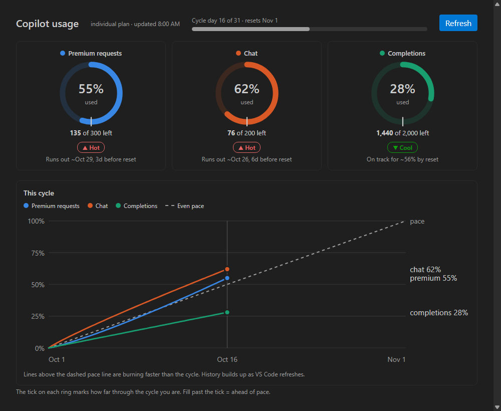

# Copilot HUD

A VS Code status bar HUD for your GitHub Copilot quota.

- **Status bar:** the quota you've used the most of, as a bar and percent (e.g. `chat ▰▰▱▱▱ 40%`). Yellow at 60%, red at 80%.
- **Hover:** a bar per quota (premium requests, chat, completions) with remaining count and overage, plus a **cycle** bar showing how far you are through the billing month and when it resets. Used % ahead of cycle % = on pace to run out early.
- **Dashboard:** click the status bar item for a full panel — a ring gauge per quota with a tick marking how far you are through the billing cycle, a burn-rate forecast (*Cool / On pace / Hot*, and "runs out ~Oct 26, 6d before reset"), and a chart of this cycle's usage against an even-pace line.
- **Alerts:** a one-time warning when any quota crosses 75% and 90% (once per cycle).
- **History:** snapshots are kept locally (VS Code global state) so the chart fills in over the cycle.
- Refreshes every 5 minutes, or hit Refresh in the dashboard.



```
chat        ▰▰▰▰▱▱▱▱▱▱  40%  120/200 left
completions ▰▱▱▱▱▱▱▱▱▱  10%  1800/2000 left
cycle       ▰▰▰▰▰▱▱▱▱▱  51%  resets 2026-11-01
```

## Install

1. Download `copilot-hud-*.vsix` from [Releases](https://github.com/VAROIndustries/VSCodeCoPilotHUD/releases).
2. `code --install-extension copilot-hud-0.1.0.vsix` (or Extensions view → `...` → *Install from VSIX...*).
3. Reload the window. Sign in to GitHub in VS Code if prompted.

## How it works

It uses your existing VS Code GitHub sign-in to read `api.github.com/copilot_internal/user` — the same endpoint Copilot's own usage display uses. Your token never leaves VS Code except to call GitHub. The endpoint is undocumented, so if GitHub changes it the HUD shows `Copilot: ?` instead of breaking.

It can't show the live chat context window size — Copilot doesn't expose that to extensions.

## Develop

Plain JavaScript, no dependencies, no build step. `node test.js` runs the self-check. `npx @vscode/vsce package` builds the `.vsix`.

## License

MIT
